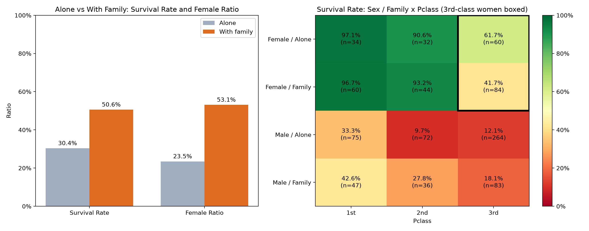

# Titanic

A data-analysis assignment on the Kaggle Titanic training set: does travelling with family change survival, and how much of that is explained by who travels with family?



## Problem

A simple split suggests passengers with family survived more often than those travelling alone. But the two groups differ in sex and class, which are the strongest survival factors, so the raw comparison can mislead.

## Approach

- Single script (`main.py`, pandas + matplotlib): load `train.csv` (891 passengers), fill missing `Age` with the median and `Embarked` with the mode.
- Group family size (`SibSp + Parch`) into alone / 2–4 / 5+, then compare survival with groupby and a pivot table by sex × family × class.
- Save the plots to `imgs/`.

## Results

| Group | Survival | Passengers | Female share |
|---|---|---|---|
| Alone | 30.4% | 537 | 23.5% |
| Family of 2–4 | 57.9% | 292 | 53.1% |
| Family of 5+ | 16.1% | 62 | 53.2% |

- Survival rises from alone to small families and falls for large ones.
- Passengers with family survived more (50.6% vs 30.4%), but the family group is also 53.1% female versus 23.5% for those alone, so part of the gap is the sex mix.
- Third-class women: 61.7% alone (60 passengers) vs 41.7% with family (84).

Full console output of the run: [results.txt](results.txt).

## Tech stack

Python, pandas, matplotlib

## Run

Download `train.csv` from [Kaggle: Titanic](https://www.kaggle.com/competitions/titanic/data) into the repo root, then:

```bash
python main.py
```

## Lessons learned

- A raw rate difference between groups can mostly reflect a difference in who is in them; splitting by sex and class first changes the reading.
- Within men, travelling with family still went with higher survival in every class, so the sex mix does not explain the whole gap.
- The groups behind some cells are small (e.g. 60 and 84 third-class women), and no significance test was run.
